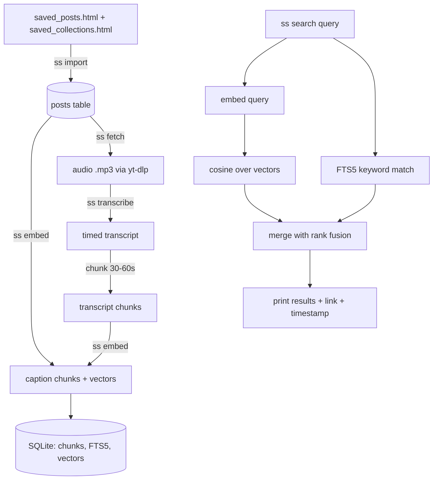

# saved-search: plan (Rust CLI)

Search 2,493 saved Instagram posts by what they say, not just by caption.
Local only, free models only, one SQLite file.

## Goal

```
$ ss search "how to ask a good question in an interview"

 1  0.82  reel  @sarabjeetsachar  [money]
       "...ask them what success looks like in the first 90 days..."  at 0:12
       https://www.instagram.com/reel/DanFuOCIYD-/
 2  0.77  reel  ...
```

## What the export gives us

| Item | Value |
|---|---|
| File | `your_instagram_activity/saved/saved_posts.html` (HTML, not JSON) |
| Posts | 2,493 (2,141 reels, 352 `/p/` posts) |
| Fields per post | url, caption, hashtags, owner username |
| Collections | `saved_collections.html` maps posts to collection names |
| Videos | not included, must be downloaded |

## Flow



Each post moves through a status, so every step is resumable:

```
imported -> audio_ready -> transcribed -> embedded
                 \-> failed (error saved, retry later)
```

## Commands

| Command | What it does | Touches Instagram |
|---|---|---|
| `ss import <export_dir>` | Parse HTML into SQLite | no |
| `ss embed` | Embed all chunks that have no vector yet | no |
| `ss search "<text>"` | Hybrid search, top 10 | no |
| `ss fetch --limit 50` | Download audio for the next 50 posts | yes |
| `ss transcribe` | Whisper on downloaded audio, store chunks | no |
| `ss stats` | Counts per status, failures | no |
| `ss open <id>` | Open the post link in the browser | no |

Search filters: `--collection money`, `--owner name`, `--kind reel|post`, `--top 20`.

## Data model

```sql
posts(
  id INTEGER PRIMARY KEY,
  shortcode TEXT UNIQUE,     -- DanFuOCIYD-
  url TEXT, kind TEXT,       -- reel | post
  owner TEXT, caption TEXT, hashtags TEXT,
  collection TEXT,
  status TEXT, error TEXT
)

chunks(
  id INTEGER PRIMARY KEY,
  post_id INTEGER REFERENCES posts(id),
  source TEXT,               -- caption | transcript
  start_s REAL, end_s REAL,  -- null for caption
  text TEXT,
  embedding BLOB             -- f32 little-endian
)

chunks_fts  -- FTS5 virtual table over chunks.text
```

## Crates

| Need | Crate | Why |
|---|---|---|
| CLI args | `clap` | standard, derive style |
| SQLite + FTS5 | `rusqlite` (feature `bundled`) | FTS5 included, no system lib |
| HTML parse | `scraper` | CSS selectors over the export |
| HTTP to Ollama | `ureq` | blocking, no async to learn yet |
| JSON | `serde`, `serde_json` | Ollama request/response |
| Errors | `anyhow` | simple `?` everywhere |
| Table output | plain `println!` first | add `comfy-table` only if needed |

## External tools (shelled out with `std::process::Command`)

| Tool | Used for | Install |
|---|---|---|
| `yt-dlp` | download audio | brew |
| `ffmpeg` | audio conversion for yt-dlp and whisper | brew |
| `whisper-cpp` | local speech to text | brew |
| `ollama` + `bge-m3` | local multilingual embeddings | brew + `ollama pull bge-m3` |

All free and local. No API keys, no paid models.

## Design decisions

1. **No vector extension.** 2,500 posts is roughly 30k chunks. Brute-force cosine over f32 vectors in Rust takes milliseconds, and it avoids loading `sqlite-vec` from Rust.
2. **Hybrid search.** Vectors find meaning, FTS5 catches exact names and tool names. Merge with reciprocal rank fusion (`score = sum of 1 / (60 + rank)`).
3. **Shell out for whisper and yt-dlp.** Rust bindings for whisper need a C++ toolchain build. A subprocess is simpler and easy to swap.
4. **Blocking code only.** One thing at a time, easier to read while learning Rust.
5. **Caption chunks first.** Search works after `import` + `embed`, before any download.
6. **Throttled fetch.** 5-15s random sleep, `--limit` per run, cookies from the browser via `--cookies-from-browser`. Failures are stored and skipped, never retried in a loop.

## Phases

| # | Milestone | Done when | Tests |
|---|---|---|---|
| 1 | Project + `import` | `ss stats` shows 2,493 posts, collections filled | parse a small HTML fixture, unique shortcodes |
| 2 | `embed` caption chunks | 2,470 caption chunks have vectors | embedding blob round-trips to f32 |
| 3 | `search` | caption search returns sane top 10 | cosine of identical vectors is 1.0; fusion ordering |
| 4 | `fetch` | 50 audio files downloaded, statuses updated | status transitions; skip already done |
| 5 | `transcribe` + chunking | transcripts stored with timestamps | chunker splits on time window, keeps order |
| 6 | Polish | `--collection`, `--owner`, `ss open`, nicer output | filter query tests |
| 7 | Later | OCR for silent reels, similar-post, duplicate finder | n/a |

Phases 1 to 3 give a working tool with zero Instagram traffic.

## Risks

| Risk | Handling |
|---|---|
| Instagram blocks or rate-limits downloads | small batches, sleeps, resume with `--limit` |
| Deleted or private posts | mark `failed`, keep caption-only search for them |
| Hinglish transcription quality | try `small` first, move to `medium` if poor; keep caption as fallback |
| Silent or music-only reels | caption + hashtags still indexed; OCR in phase 7 |
| Export HTML layout changes | parser isolated in one module, fixture test catches it |

## Suggested layout

```
saved-search/
  Cargo.toml
  src/
    main.rs          -- clap commands, dispatch
    db.rs            -- schema, queries
    import.rs        -- HTML parse
    embed.rs         -- Ollama client, blob encode/decode
    fetch.rs         -- yt-dlp wrapper
    transcribe.rs    -- whisper wrapper, chunker
    search.rs        -- cosine, FTS, fusion
  tests/fixtures/saved_posts_small.html
```

## Open questions

1. Project folder name and location (suggested `~/Developer/saved-search/`).
2. Embedding model: `bge-m3` (multilingual, larger) or `nomic-embed-text` (English-leaning, smaller)?
3. Whisper model size to start with: `small` or `medium`?
